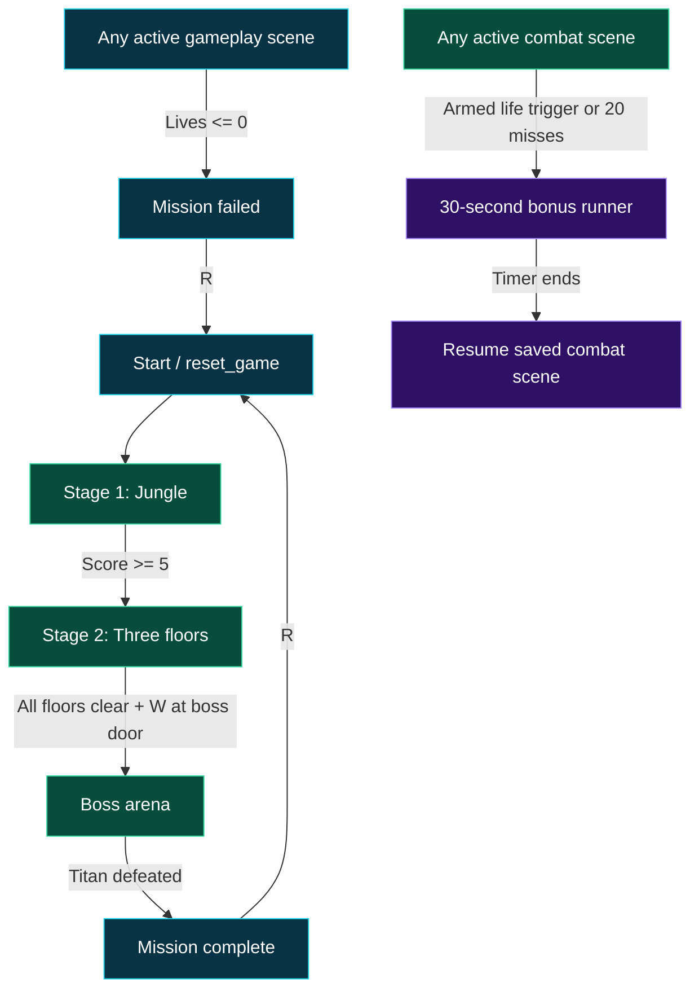

<div align="center">

# Monster Hunter

### Multi-Stage Jungle Survival

Fight through the Amazon jungle, climb an enemy-filled temple, and defeat the Jungle Titan in a Python/OpenGL survival game.


**Survive the jungle. Clear the temple. Challenge the Titan.**

[Overview](#overview) · [Features](#features) · [Gameplay](#gameplay) · [Controls](#controls) · [Quick Start](#quick-start) · [Architecture](#architecture) · [Roadmap](#roadmap)

</div>

---

<a id="overview"></a>

## ✨ Overview

**Monster Hunter: Multi-Stage Jungle Survival** is a single-player desktop game built with Python and PyOpenGL. It combines a freely navigable jungle arena, side-view combat across three temple floors, a final boss encounter, and a three-lane bonus runner.

The supplied implementation is a **single Python script**. It draws its player, enemies, scenery, projectiles, and pickups using OpenGL primitives and GLU/GLUT geometry. It does not load external models, textures, audio, or map files.

Gameplay centers on movement, directional aiming, projectile collisions, lives, shields, and score. A temporary bonus stage gives the player a chance to collect supplies before returning to the interrupted combat scene.

### 🎯 Project objectives

- Build an interactive game using OpenGL transformations, projection, and primitive geometry.
- Combine distinct combat and runner scenes within one state-driven application.
- Implement enemy pursuit, projectile motion, collision detection, and health management.
- Support keyboard/mouse input and scene-specific camera views.
- Present progress through an on-screen HUD, victory screen, and game-over screen.

---

<a id="features"></a>

## 🚀 Features and implementation status

| Feature | Status | Details |
| --- | --- | --- |
| Jungle combat arena | 🟢 Implemented | Five respawning monsters pursue the player in a bounded arena. |
| Three-floor temple | 🟢 Implemented | Clear five enemies on each floor and use alternating stair connections. |
| Final boss encounter | 🟢 Implemented | Fight the Jungle Titan, avoid projectiles, and handle cycling minions. |
| Bonus runner | 🟢 Implemented | A 30-second, three-lane stage with pickups, rocks, and logs. |
| Weapon upgrades | 🟢 Implemented | Single, three-shot, and five-shot firing patterns in Stage 1. |
| Lives and shields | 🟢 Implemented | Life pickups restore health; up to two shields absorb damage events. |
| Enemy variants | 🟢 Implemented | Normal, fast, heavy, and boss enemies with different properties. |
| Projectile collision checks | 🟢 Implemented | Swept collision checks select the nearest intersected target. |
| Camera switching | 🟢 Implemented | First-person and adjustable third-person views in Stage 1. |
| Animated visuals | 🟢 Implemented | Pulsing enemies, a pulsing boss core, and interpolated stair travel. |
| HUD and end screens | 🟢 Implemented | Lives, score, shields, stage details, and restart prompts. |
| Restart | 🟢 Implemented | Press `R` after victory or defeat to reset the run. |

These statuses describe the supplied source. They do not represent completed runtime testing across operating systems.

---

<a id="gameplay"></a>

## 🕹️ Gameplay and progression

### Stage 1: Amazon Jungle

Start with **6 lives**, weapon level **1**, and no shields. Five normal monsters spawn near the edges of the jungle and move toward the player. Defeated monsters respawn, and each normal-monster defeat awards one point.

Move forward or backward, rotate to aim, and fire with the left mouse button. Reach **5 points** to advance automatically to Stage 2.

The scene includes checkerboard ground, trees, rocks, ruins, and boundary walls. Movement is constrained to the arena bounds; decorative scenery is not a separate obstacle-collision system.

### Stage 2: Three-Floor Temple

This stage switches to a fixed side view. Move left or right to face enemies, then fire horizontally.

| Floor | Enemy composition | Route upward |
| --- | --- | --- |
| 1 | 3 normal, 2 fast | Clear the floor, move near the right stairs, and press `W`. |
| 2 | 2 normal, 2 fast, 1 heavy | Clear the floor, move near the left stairs, and press `W`. |
| 3 | 1 normal, 2 fast, 2 heavy | Clear all floors, move to the right-side boss door, and press `W`. |

Stair travel lasts **0.6 seconds**. Movement and firing are suspended while climbing. Press `S` near the appropriate connector to descend to an earlier floor.

Only enemies on the active floor update during combat. Cleared enemies remain removed rather than respawning.

### Final Boss: Jungle Titan

The boss arena restores free movement and rotational aiming, with a fixed elevated camera. The Jungle Titan starts with **5 health** and pursues the player while launching aimed projectiles.

- Boss contact and boss projectiles cause **2 damage** without a shield.
- A minion causes **1 damage** on contact.
- One minion is active initially. Defeated minions are replaced in a **normal → fast → heavy** cycle.
- Enemy movement becomes faster as the Titan loses health. The HUD displays **Rage Phase** when its health reaches **2 or less**.
- Defeating the Titan awards **20 points** and displays **MISSION COMPLETE**.

The firing interval is at least 1.8 seconds, and the code allows only one active boss projectile at a time.

### Bonus Stage: Temple Run

The bonus runner can interrupt **Stage 1, Stage 2, or the boss arena** when either condition is met:

1. Lives fall to **4 or fewer** while the life trigger is armed.
2. **20 missed player bullets** have been recorded since the last bonus entry.

A bullet counts as missed when it leaves the combat bounds without hitting an enemy. With spread fire, each escaping projectile counts separately.

During the **30-second** bonus stage, switch between three lanes to collect supplies and avoid obstacles. Combat progression is preserved so you can return to the scene you left.

| Object | Appearance | Effect |
| --- | --- | --- |
| Life pickup | Red cross | Adds 1 life; no maximum life cap is defined. |
| Weapon pickup | Gold weapon | Increases Stage 1 weapon level, up to level 3. |
| Shield pickup | Blue shield | Adds one shield charge, up to 2. |
| Rock | Gray/brown cluster | Causes 1 damage unless a shield absorbs it. |
| Log | Brown cylinder | Causes 1 damage unless a shield absorbs it. |

Weapon pickups are offered only when returning to Stage 1; that pickup probability becomes additional life pickups for other combat scenes.

Entering bonus mode clears active projectiles, resets the missed-bullet counter, and disarms the life trigger. The life trigger re-arms when lives rise above 4 during combat. The missed-bullet trigger can still activate independently.

### Weapons, scoring, and survival

| Stage 1 weapon level | Projectiles per click | Spread offsets |
| --- | --- | --- |
| 1 | 1 | `0°` |
| 2 | 3 | `-8°`, `0°`, `+8°` |
| 3 | 5 | `-12°`, `-6°`, `0°`, `+6°`, `+12°` |

Weapon level resets to 1 when entering Stage 2 and the boss arena. Both use single shots with a **0.30-second** firing cooldown.

| Enemy | Stage 1 health | Stage 2 health | Boss-arena health | Defeat score |
| --- | --- | --- | --- | --- |
| Normal | 1 | 2 | 3 | 1 |
| Fast | Not spawned | 2 | 2 | 2 |
| Heavy | Not spawned | 5 | 6 | 3 |
| Jungle Titan | Not spawned | Not spawned | 5 | 20 |

One shield charge absorbs an entire damage event, including a two-damage boss hit. If lives reach **0 or below**, the game displays **MISSION FAILED**. Scores and progress remain in memory for the current run.

---

<a id="controls"></a>

## 🎮 Controls

Controls vary by scene. Click the game window to focus it before using the keyboard.

| Input | Stage 1 | Stage 2 | Boss arena | Bonus runner |
| --- | --- | --- | --- | --- |
| `W` | Move forward | Climb unlocked stairs / enter boss door | Move forward along aim direction | No action |
| `S` | Move backward | Descend near stairs | Move backward along aim direction | No action |
| `A` | Rotate counterclockwise | Move left and face left | Rotate aim counterclockwise | Move one lane left |
| `D` | Rotate clockwise | Move right and face right | Rotate aim clockwise | Move one lane right |
| Left mouse button | Fire | Fire when not climbing | Fire | No action |
| Right mouse button | Toggle first/third-person camera | No action | No action | No action |
| Left/right arrows | Orbit third-person camera | No action | No action | Change lane |
| Up/down arrows | Raise/lower third-person camera | No action | No action | No action |

- **`R`:** Restart after victory or game over. It does not reset an active run.
- **Exit:** Close the game window. The script has no custom Escape-key handler.
- Camera arrows apply only to **Stage 1's third-person view**.
- Movement is handled through keyboard callbacks; sustained movement depends on keyboard repeat behavior.

---

<a id="quick-start"></a>

## ⚙️ Getting started

### Prerequisites

- Python 3 with pip.
- An OpenGL-capable desktop graphics environment.
- Native OpenGL, GLU, and GLUT/FreeGLUT libraries available to Python.
- A keyboard and mouse.

### 1. Save the game script

Save the supplied Python code as **`game.py`** in a dedicated game folder. Place this README beside it. `game.py` is a suggested filename for the pasted source, not an additional file supplied with this documentation.

### 2. Create a virtual environment

From your game folder:

```bash
python -m venv .venv
```

Activate it on Windows PowerShell:

```powershell
.venv\Scripts\Activate.ps1
```

Or on macOS/Linux:

```bash
source .venv/bin/activate
```

Use `python3` instead of `python` where your system requires it, or `py` with the Windows Python launcher.

### 3. Install the Python dependency

```bash
python -m pip install PyOpenGL
```

The optional acceleration package can also be installed:

```bash
python -m pip install PyOpenGL_accelerate
```

PyOpenGL's installation documentation describes pip installation and the optional acceleration package. Native graphics libraries are separate runtime requirements. See the [PyOpenGL installation guide](https://pyopengl.sourceforge.net/documentation/installation.html) and [FreeGLUT installation instructions](https://freeglut.sourceforge.net/docs/install.php) for platform-specific setup.

The modules `math`, `random`, and `time` are included with Python and need no separate installation.

### 4. Launch the game

```bash
python game.py
```

The script creates a **1000 × 800** window titled **Monster Hunter Multi-Stage Jungle Survival** and immediately begins Stage 1.

---

<a id="architecture"></a>

## 🏗️ Architecture and game loop

### Game-state flow



### Main components

| Component | Key functions | Responsibility |
| --- | --- | --- |
| Initialization | `main`, `reset_game` | Initialize state, create the window, and register GLUT callbacks. |
| Input | `keyboardListener`, `specialKeyListener`, `mouseListener` | Interpret scene-specific controls. |
| Update loop | `idle`, `update_stage2`, `update_boss`, `update_bonus` | Advance the active scene and evaluate transitions. |
| Combat | `fire_bullet`, `damage_player`, `nearest_2d_target` | Spawn shots, apply damage, and resolve projectile targets. |
| Collision math | `swept_circle_hit_fraction` | Test the projectile's motion segment against a target's collision circle. |
| Scene transitions | `start_stage2`, `start_boss`, `start_bonus_mode`, `return_from_bonus` | Change scenes and retain relevant progress. |
| Camera | `setupCamera` | Configure perspective and the view for the current scene. |
| Rendering | `showScreen`, `draw_player_model`, `draw_monster`, scene drawing functions | Draw geometry and HUD, then swap buffers. |

`idle()` calculates elapsed time and limits each simulation step to **0.05 seconds**. Enemy and projectile movement use that delta time. Player movement and rotation advance by fixed increments in keyboard callbacks.

The renderer uses immediate-mode OpenGL and a fixed-function matrix pipeline. GLUT provides the window and event loop, while GLU supplies perspective/view helpers and quadric shapes. These PyOpenGL modules are described in the [official PyOpenGL overview](https://pyopengl.sourceforge.net/index.html).

---

## 🛠️ Technology stack

| Technology | Purpose |
| --- | --- |
| Python 3 | Game logic, state, and callbacks. |
| PyOpenGL / `OpenGL.GL` | Drawing, colors, transformations, and buffers. |
| `OpenGL.GLU` | Perspective, camera setup, spheres, and cylinders. |
| `OpenGL.GLUT` | Window creation, keyboard/mouse callbacks, bitmap text, and cube geometry. |
| `math` | Angles, direction vectors, distances, and collision calculations. |
| `random` | Spawn positions, monster animation phases, and bonus item selection. |
| `time` | Frame timing, cooldowns, stair animation, and bonus duration. |

---

## 📁 Suggested project layout

After saving the supplied code, a minimal game folder can contain:

```text
monster-hunter/
├── game.py       # Supplied Python code, saved under this suggested name
└── README.md     # This documentation
```

No asset directory, web server, database, API key, or network service is required by the game code.

---

## 🔧 Gameplay configuration

Adjust the constants near the top of the script to experiment with difficulty and pacing.

| Constant | Default | Purpose |
| --- | --- | --- |
| `WINDOW_WIDTH`, `WINDOW_HEIGHT` | `1000`, `800` | Window dimensions. |
| `INITIAL_LIFE` | `6` | Starting lives. |
| `STAGE1_SCORE_TARGET` | `5` | Score needed to leave Stage 1. |
| `MONSTER_COUNT` | `5` | Stage 1 monster population. |
| `BULLET_SPEED` | `430.0` | Player projectile speed. |
| `SIDE_FIRE_COOLDOWN` | `0.30` | Stage 2 and boss firing cooldown, in seconds. |
| `BONUS_LIFE_TRIGGER` | `4` | Life threshold for the armed bonus trigger. |
| `BONUS_MISS_TARGET` | `20` | Missed-bullet threshold for bonus entry. |
| `BONUS_DURATION` | `30.0` | Bonus duration, in seconds. |
| `BOSS_MAX_HEALTH` | `5` | Titan starting health. |
| `BOSS_PROJECTILE_DAMAGE` | `2` | Damage from a boss projectile. |
| `STAIR_TRAVEL_TIME` | `0.60` | Duration of a stair transition, in seconds. |

Window size changes also require reviewing the hardcoded HUD coordinates and projection aspect ratio.

---

## 🧪 Testing and troubleshooting

The supplied code contains no automated test suite. The following are suggested manual checks after setting up the graphics runtime:

| Area | What to verify |
| --- | --- |
| Startup | The window opens, the jungle renders, and the HUD shows 6 lives. |
| Input | Movement, aiming, firing, and Stage 1 camera controls respond correctly. |
| Progression | A score of 5 starts Stage 2; cleared floors unlock the expected route. |
| Bonus entry | An armed life threshold or 20 misses opens the runner. |
| Pickups | Lives increase, shields cap at 2, and Stage 1 upgrades alter shot patterns. |
| Bonus return | After 30 seconds, the original combat scene resumes with its progress. |
| Boss | Health decreases on hits, minions cycle, and victory occurs at zero Titan health. |
| Restart | `R` resets score, lives, shields, upgrades, and stages after an end screen. |

### Common setup issues

**`ModuleNotFoundError: No module named 'OpenGL'`**

Install PyOpenGL using the same Python interpreter that launches `game.py`. Check that your virtual environment is active.

**GLUT cannot initialize or a GLUT function is unavailable**

Check that the native GLUT/FreeGLUT runtime is installed and discoverable by Python. A Python package installation alone may not supply the native runtime for your platform. Use the [official FreeGLUT setup instructions](https://freeglut.sourceforge.net/docs/install.php).

**Objects appear in an unexpected front-to-back order**

The script requests a depth buffer but does not explicitly enable `GL_DEPTH_TEST`. Enabling depth testing during initialization is a potential rendering improvement to evaluate.

**The game behaves differently when the window is resized**

The script uses fixed viewport dimensions, a hardcoded aspect ratio, and fixed HUD coordinates. It does not register a reshape callback.

---

<a id="roadmap"></a>

## 🗺️ Development roadmap

Checked items are present in the supplied source. Unchecked items are suggested enhancements.

- [x] Jungle combat, three-floor progression, and a final boss
- [x] Bonus runner with lives, shields, and Stage 1 weapon upgrades
- [x] Enemy pursuit and swept projectile collisions
- [x] Stage-specific controls, camera views, HUD, and restart
- [ ] Add a start menu, pause controls, and an explicit exit shortcut
- [ ] Support window resizing and adaptable HUD placement
- [ ] Enable and verify depth testing for scene rendering
- [ ] Make player movement time-based instead of dependent on keyboard repeat
- [ ] Separate rendering, combat, input, and stage logic into modules
- [ ] Add automated tests for scoring, damage, and state transitions
- [ ] Add sound effects and optional saved high scores

---

## ❓ Frequently asked questions

**Do weapon upgrades carry into every stage?**

Upgrades affect Stage 1 spread fire. Entering Stage 2 or the boss arena resets weapon level to 1.

**Why does the bonus runner not immediately repeat when lives remain at 4?**

Entering bonus mode disarms the life trigger. It re-arms when lives rise above 4 during combat. Reaching 20 misses can trigger another bonus independently.

**Can the game end during the bonus stage?**

Yes. Rocks and logs can reduce lives to zero, triggering game over.

**Can I aim with mouse movement?**

Mouse movement is not used for aiming. Use `A` and `D` to rotate in the jungle and boss arena, or to change facing direction in Stage 2.

**Does the game save progress or high scores?**

State exists only in memory. Restarting resets the run, and the source has no save/load system.

---

## 🤝 Contributing

Keep changes focused on a gameplay mechanic, rendering improvement, or setup fix. Document changed controls and constants, and include the relevant manual checks when sharing changes.

---

## 📄 License

The supplied source does not include a license declaration. Add an appropriate license file when publishing the project.

---

<div align="center">

### 🌴 Monster Hunter: Multi-Stage Jungle Survival

*A journey through jungle combat, temple encounters, and a final Titan showdown.*


</div>
